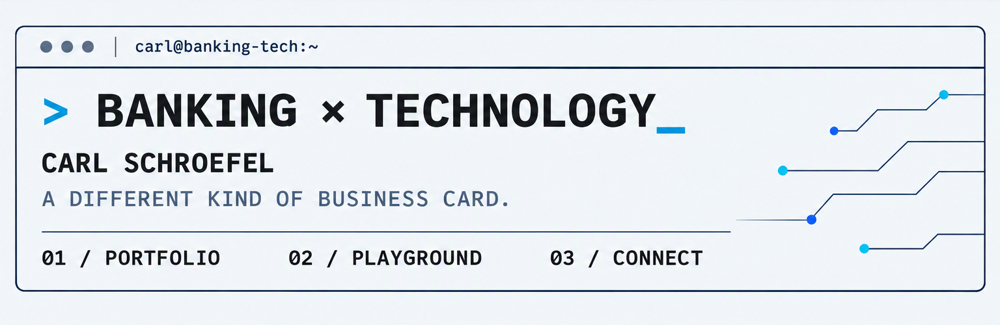

<picture>
  <source media="(prefers-color-scheme: dark)" srcset="./assets/hero-dark.png">
  <source media="(prefers-color-scheme: light)" srcset="./assets/hero-light.png">
  
</picture>

<br>

```console
carl@banking-tech:~$ whoami

> translating_technology_into_conversations
> connecting_banking_with_external_expertise
> building_a_different_kind_of_business_card

carl@banking-tech:~$ ls

> open_for_conversation

carl@banking-tech:~$ _
```

## `01 / PORTFOLIO`

### 🗺️ Banking Technology Landscape

A compact view of the technologies, architectures and regulatory topics I encounter across Banking IT.

**https://github.com/carl-schroefel/banking-technology-landscape**

`Cloud` `Data & AI` `Cyber Security` `Architecture` `Software Engineering` `Payments` `RegTech`

---

## `02 / PLAYGROUND`

### 🎮 Banking IT, but slightly less serious.

Small experiments, games and other ways to explore Banking Technology.

**Coming soon**

`Banking IT Buzzword Bingo` · `DORA or Dinosaur?` · `Build your Bank Tech Stack`

---

## `03 / CONNECT`

### ☕ Let's talk.

No sales deck required.

**📧 Email**  
carl.schroefel@hays.de

**💼 LinkedIn**  
https://www.linkedin.com/in/carl-justin-schroefel/

**📅 Microsoft Bookings**  
Coming soon

**💬 Microsoft Teams**  
Coming soon

